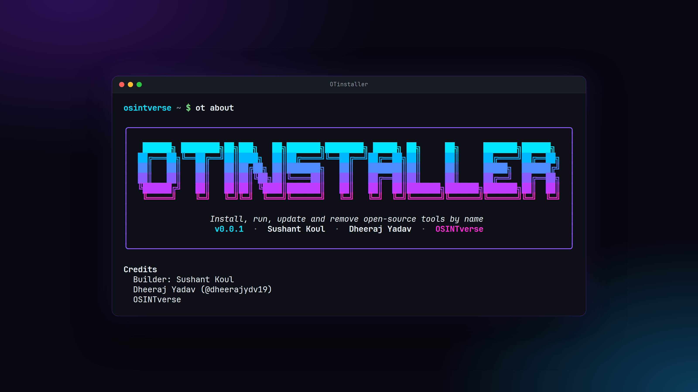
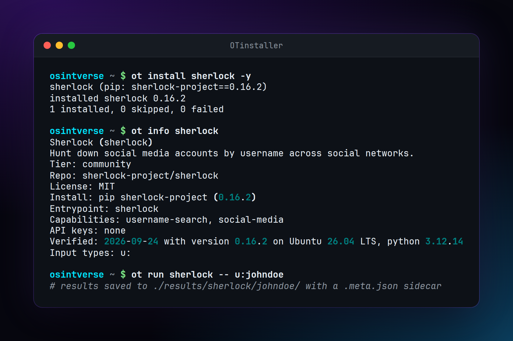

# OTinstaller

OTinstaller is a command line tool manager for Linux. It installs, runs, updates
and removes open-source command line tools by name, each in its own virtualenv,
through one standard command interface. `ot` is a short alias for `otinstaller`.

You pick a tool by name. OTinstaller installs it, runs it against a target, and
saves the output under `./results/` with a metadata sidecar file. You do not learn
a different install method for every tool.

This site covers 47 tools. The tool list focuses on open-source intelligence
(OSINT) tooling and is rebuilt from the OTinstaller registry whenever the registry
changes.

## Contents

- [Getting started](getting-started.md): install OTinstaller, run `otinstaller
  init`, and run your first tool.
- [Changelog](changelog.md): what changed in each release.
- [Tools](SUMMARY.md): one page per tool with source, install method, credentials,
  input flags, example output, and run commands.

## Links

- Source code: [github.com/OSINTVerseHQ/OTinstaller](https://github.com/OSINTVerseHQ/OTinstaller)
- Package: [pypi.org/project/otinstaller](https://pypi.org/project/otinstaller/)
- Report a bug or suggest a tool: [issues](https://github.com/OSINTVerseHQ/OTinstaller/issues)

## Team

- **Sushant Koul**, builder: [GitHub](https://github.com/Sushant-69x) ·
  [LinkedIn](https://www.linkedin.com/in/sushantkoul07)
- **Dheeraj Yadav**: [GitHub](https://github.com/dheerajydv19) ·
  [X](https://x.com/dheerajydv19)

Built by [OSINTverse](https://osintverse.com/).
